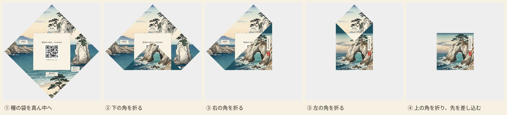

# 種つつみ（tane-tsutsumi）

一枚の紙を折って差し込むだけで閉じる、薬包のような種の包みです。絵と QR を差し替えて、A4 で印刷できます。誰でも無料で使えます。

既定のデザインは、鳥取県岩美町の駅前で育ったかぼちゃの種を配るために作りました。

- **絵を差し替えて使う：** https://social-calculus.github.io/tane-tsutsumi/ （ブラウザだけで動きます。入れた絵はどこにも送られません）
- **そのまま印刷する：** [`dist/tane-tsutsumi_iwami_a4.pdf`](dist/tane-tsutsumi_iwami_a4.pdf)（3 デザイン・両面 6 ページ）

## 作り方

1. 両面、**長辺とじ**、倍率 100% で A4 に印刷します。ふつうのコピー用紙が折りやすいです。
2. 点線の 4 辺を切ります（約 19.8cm 四方）。下の部分は捨てます。
3. QR のある面を上に、角を上にして置き、種の袋を真ん中に置きます。
4. 中央の四角の線で、下の角、右の角、左の角の順に折ります。
5. 上の角を折り、先を左右の重なりの下へ差し込みます。約 11cm 四方になります。

角がそれぞれ中心を越えて重なるので、シールなしで閉じ、中身もこぼれません。

## 差し替える

ページの画面で、デザインごとに外側の絵と内側の大きな絵を選び、中央の QR の行き先と文字を変えられます。「印刷する」から PDF に保存できます。

手元で作るなら、`designs/designs.js` を書き換えて `index.html` を開きます。

- 絵は正方形です。内側の絵は紙を角が上になるように置いたときの上下で描き、四隅は切れるので、大事なものは中央寄りに置きます。真ん中は QR の四角で隠れます。
- 開いたときの小さな札（`labels`）は位置も文字も変えられます。
- 折り上がりの版面の計算は `tane.js`、折り工程の確かめは `tools/build.py` にあります。

## ライセンス

- デザイン（絵・版面・文章）：[CC BY 4.0](LICENSE)
- コード：[MIT](LICENSE-CODE)
- 表示の例：「種つつみ（SOCIAL CALCULUS）を改変」と、このページへのリンク

既定の絵は AI で生成しました。実際の景色そのものではなく、岩美をもとにしたイメージです。国によっては著作権が生じない場合があり、その範囲では CC BY の条件もかかりません。

このデザインは岩美町の公式なものではありません。町章やキャラクターは含みません。別の用途で使うときは、中央の QR と裏の表示欄を自分のものに差し替えてください。

種を配るときは、登録品種でないことを確かめ、「食べられません」など必要な表示を入れてください。

---

## English

A seed packet folded from one sheet of A4, like an old paper medicine wrap. The flaps overlap and tuck in, so it closes without glue or stickers. Swap the pictures and the QR code in your browser and print. Free to use under [CC BY 4.0](LICENSE); the code is [MIT](LICENSE-CODE). The default design comes from pumpkins grown in front of Iwami Station, Tottori, Japan.

Print double-sided (flip on long edge) at 100%, trim the four dashed lines, put the seeds in the middle, fold the bottom, right and left corners along the center square, then fold the top corner and tuck its tip under the overlap. The default artwork is AI-generated and is an impression, not a record of real places. This project is not an official work of Iwami Town.
