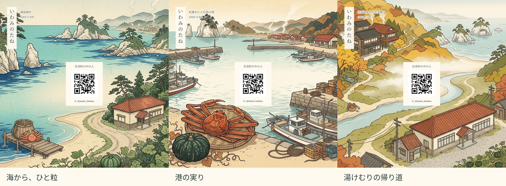

# 岩美のたね

**一枚の風景画を、小さな薬包のように折る種の包み。** 192 mm の正方形から、のり・シール・切り込みなしで 64 mm 角の「たとう包み」を作ります。最後の翼を最初の翼の下に差し込む、風車式です。

**配布データは試し刷り用として完成。実物の保持力試験は未実施です。** 11/8 に実際の用紙と種の袋で確認し、合格後、11/11 に各柄20枚・計60枚を印刷する想定です。11/14 の配布用。



- [印刷用 PDF：3柄・6ページ](dist/tane-tsutsumi_iwami_a4.pdf)（A4 3枚分）
- 個別 PDF：[海から、ひと粒](dist/umi-a4.pdf) / [港の実り](dist/kani-a4.pdf) / [湯けむりの帰り道](dist/eki-a4.pdf)
- [折り方の図と試し刷り確認欄：2ページ](dist/fold-guide.pdf) / [原寸の練習用紙：1ページ](dist/practice.pdf)
- [ブラウザで絵と QR を差し替える](https://social-calculus.github.io/tane-tsutsumi/) / [編集用一式 ZIP](dist/source.zip)

## 印刷・包み方

**A4、カラー両面、長辺とじ、実際のサイズ＝100%。** 「用紙に合わせる」、フチなし拡大、製本、2ページ集約は OFF。普通の白いコピー用紙 70〜90 g/m² を推奨します。

1. 各柄の2ページが表裏の1枚です。初めは各柄1枚。下の **50 mm** の線を定規で測ります。
2. A 面のトンボを基準に、192 × 192 mm に裁断。外周9 mmの余白と下の説明部分を切り落とします。絵は裁ち位置の外へ3 mm伸びています。印刷可能範囲が紙端から6 mm以内の機械を想定しています。
3. 折り方 PDF に沿って折り筋を作ります。**中央64 mm角は折らない**ため、中央の QR は折り線をまたぎません。
4. チャックを閉じた袋を入れ、左 → 下 → 右 → 上の順に閉じ、最後の翼を最初の翼の下に差し込みます。袋は **外寸45 × 50 mm以下**。3粒は重ねず平らに。紙は外包み、種の漏れ止めはチャック袋です。

60枚の本刷りは、**6ページ PDF を20部・長辺とじで両面印刷＝60枚（120面）**。個別2ページ PDF を各20部でも同じです。折り方・練習用紙は本刷りに混ぜません。

## 確認したこと／実物で確認すること

- **実行済みのデジタル検査**：[preflight.json](dist/preflight.json)。A4・ページ数・PDFフォント埋め込み、300/150 dpi の印刷面画像から2つの QR を全柄復号、静寂域4セル、中央面の無折線、翼の平面上の重なり、差し替え動作。
- **折り方の根拠**：既存の伝統的な風車式。写真付き工程は [I Try DIY「Origami Square Envelope」](https://itrydiy.me/2016/02/origami-square-envelope/)。その写真を転載せず、折り図を独自に描きました。平面の面積計算だけを、立体折りの検証とは呼びません。
- **11/8 の実物確認**：表裏ずれ2 mm以内、紙が無理なく畳める、実袋を入れて10回開閉・10回軽く振る・逆さ30秒で翼が抜けず袋が出ない、スマホで両QRが読めること。紙厚・摩擦・種の厚みはコンピュータでは保証していません。合格するまで60枚の本刷りには進めません。

## 差し替え・再生成

ZIP を展開し `index.html` を開くだけ。各柄 **画像1枚**、中央QR・小QRのURL、題、表示欄を変更できます。編集内容は画像込みの JSON に保存・再読込でき、画像を埋め込んだ SVG も書き出せます。入力は外部へ送信しません。

`dist/*-inside.svg` と `*-outside.svg` は、画像埋め込み・mm実寸・文字とQRが別要素の編集用源稿です。Inkscape等で開けます。QRを変えるときは図形を手描きせず、ブラウザ画面で再生成してください。フォントは Noto Serif CJK JP / Noto Sans CJK JP 推奨。配布 PDF はフォント埋め込み済みです。

開発者向け（既に動いている Chromium/Brave の CDP を指定。ビルドは生図 API を呼びません）：

```sh
uv sync
node tools/guide.mjs
uv run python tools/build.py --cdp http://127.0.0.1:9222
```

必要環境は Python 3.11以降、Node.js、CDP対応ブラウザ、日本語フォントです。画像を新しく生成するときだけ `IMAGE_API_URL=... node tools/gen_art.mjs umi/scene` を実行します。対応は `yuzu_images` を返す OpenAI互換画像生成プロキシ。原画・来歴は [ASSETS.md](ASSETS.md)。

## ライセンス

デザイン・文章・独自の折り図：**[CC BY 4.0](LICENSE)**。コード：**[MIT](LICENSE-CODE)**。帰属例：「岩美のたね / SOCIAL CALCULUS、CC BY 4.0、改変あり」＋本リポジトリへのリンク。

AI生成の創作風景で、景色の位置関係を示す地図ではありません。AIのみの出力に著作権が成立しない地域・範囲では、CC BYの条件もその範囲にはかかりません。町章・いわみん・JRロゴ・『Free!』のキャラクターは使用していません。岩美町の公式制作物ではありません。
